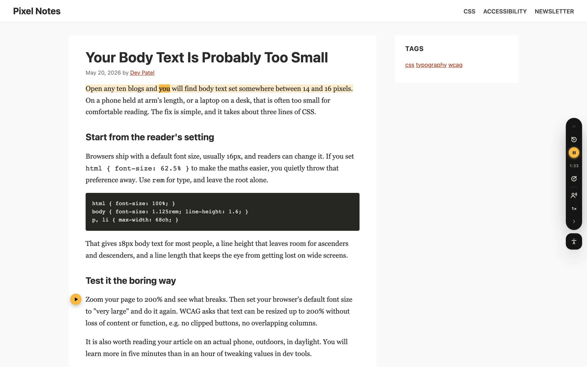
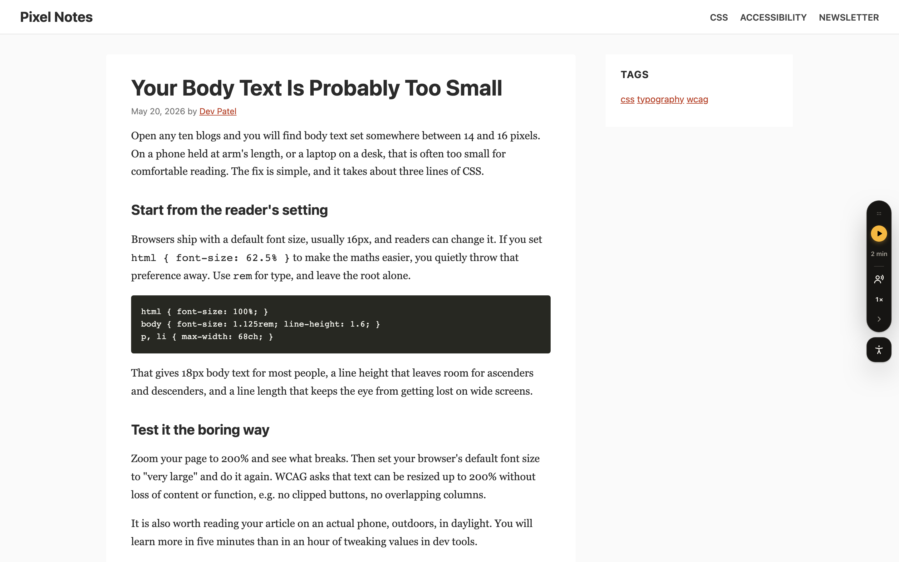
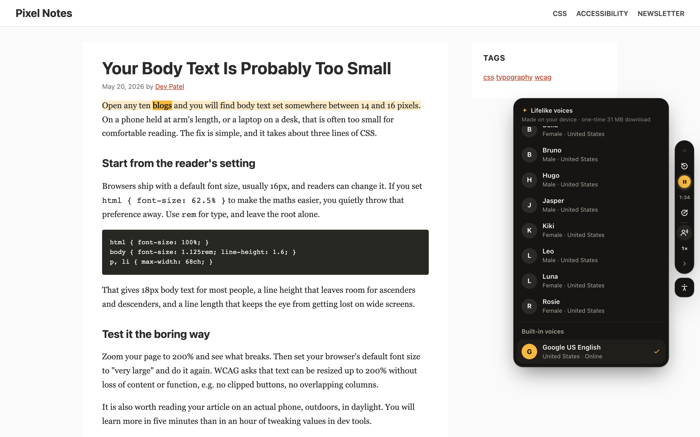
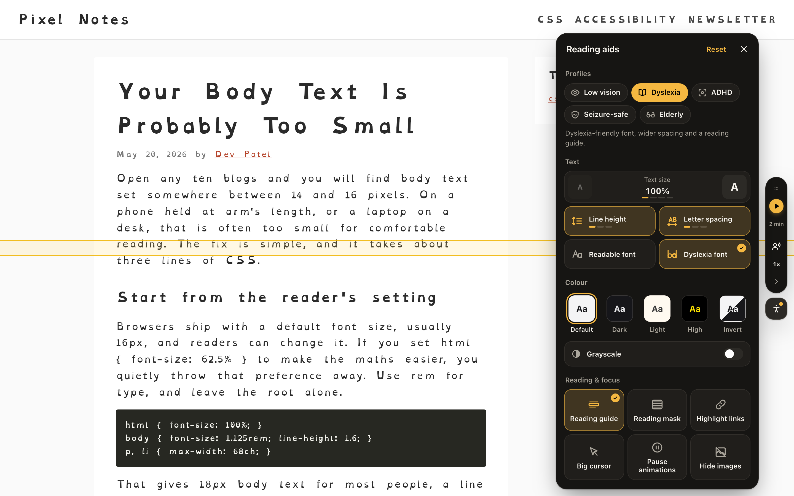
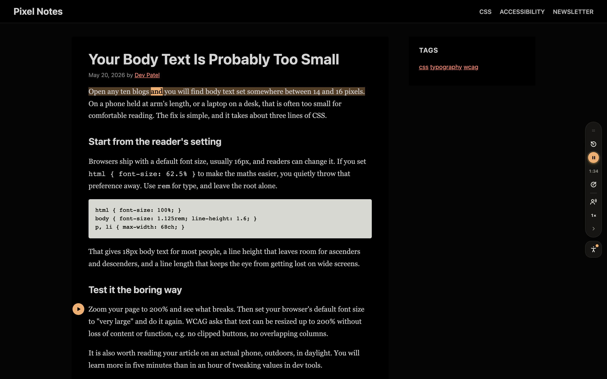

# Lantun

**Turn any article into something people can listen to, and read more comfortably.**

One script tag adds a small dock to your site. Readers press play and hear the article, with each sentence and word highlighted as it is spoken. A second button opens reading aids for low vision, dyslexia, ADHD and more. No account, no backend, no changes to your markup.



```html
<script src="https://cdn.jsdelivr.net/npm/lantun@0.1/dist/widget.js"></script>
<script src="https://cdn.jsdelivr.net/npm/lantun@0.1/dist/voice-kitten.js"></script>
```

## Why Lantun

- **Finds the article by itself.** It skips menus, ads, captions, code blocks and "Read also" links, so readers hear the story and nothing else.
- **Follows along as it reads.** The current sentence and word are highlighted, and the page scrolls gently with them.
- **Starts wherever you want.** Hover a paragraph or select some text, then press play to start there.
- **Picks up where you left off.** Come back to a half-read article and it continues from the same sentence.
- **Sounds human.** Lifelike voices run right in the reader's browser, with no server and no per-use cost. Without them, Lantun still picks the best voice the browser has.
- **Helps people read, not just listen.** Twelve reading aids and five one-tap profiles.
- **Won't break your site.** The UI lives in its own shadow root and never touches your article. It survives hostile CSS and strict Content-Security-Policies, and it can't throw errors into your page.
- **Light.** About 38 kB gzipped, with no dependencies on your side.
- **Accessible.** Fully keyboard-operable, screen-reader friendly, and checked with axe in every state.
- **Bilingual UI.** English and Indonesian, chosen from the page language.

## A closer look

<table>
  <tr>
    <td width="50%"></td>
    <td width="50%"></td>
  </tr>
  <tr>
    <td><b>Quiet until needed.</b> A slim dock shows how long the article takes to hear. Drag it to any edge, or tuck it away.</td>
    <td><b>Lifelike voices.</b> Natural English voices generated on the reader's device. They download once (31 MB) and only when a reader picks one.</td>
  </tr>
  <tr>
    <td></td>
    <td></td>
  </tr>
  <tr>
    <td><b>Reading aids.</b> Text size, line height, letter spacing, readable and dyslexia fonts, colour modes, grayscale, highlighted links, big cursor, reading guide and mask, paused animations, hidden images.</td>
    <td><b>Any page, any colour mode.</b> Dark, light, high-contrast and inverted modes, with highlights that keep your brand colour.</td>
  </tr>
</table>

## Get started

Choose the one that matches your site, and follow only that section.

- [**Any website**](#any-website): HTML pages, WordPress, Ghost, Webflow, a CMS theme. Paste two lines, no build step.
- [**JavaScript app**](#javascript-app): Vue, Svelte, Astro, plain Vite, anything with a bundler.
- [**React app**](#react-app): React, Next.js, Remix.

> [!TIP]
> **Always add the lifelike voices.** Browser voices differ from device to device, and many sound robotic. The lifelike voices sound natural everywhere and make a much better first impression. Each setup below includes them.
>
> They cost you nothing: the voices are generated on the reader's device, and nothing downloads until a reader picks one in the voice menu (about 31 MB, once). A few sentences into their first listen, Lantun suggests them to the reader. They speak English; other languages use the browser's voices.

### Any website

Paste these two lines before `</body>`:

```html
<script src="https://cdn.jsdelivr.net/npm/lantun@0.1/dist/widget.js"></script>
<script src="https://cdn.jsdelivr.net/npm/lantun@0.1/dist/voice-kitten.js"></script>
```

Done. Lantun finds the article and shows the dock when the page loads.

To customise it, add attributes to the first tag. All of them are optional:

```html
<script
  src="https://cdn.jsdelivr.net/npm/lantun@0.1/dist/widget.js"
  data-content-selector="article .entry-content"
  data-color="#7c3aed"
></script>
```

| Attribute                | Default                  | What it does                                            |
| ------------------------ | ------------------------ | ------------------------------------------------------- |
| `data-content-selector`  | auto-detected            | Where the article body is.                              |
| `data-exclude-selectors` | none                     | Comma-separated selectors that are never read aloud.    |
| `data-position`          | `right`                  | Dock side: `right` or `left`.                           |
| `data-color`             | `#f5b841`                | Highlight and accent colour; any CSS colour.            |
| `data-lang`              | `<html lang>`, then `en` | Article language; picks the voices and the UI language. |
| `data-tts`               | `true`                   | `false` turns off listening.                            |
| `data-a11y`              | `true`                   | `false` turns off reading aids.                         |
| `data-z-index`           | `2147483000`             | Stacking order.                                         |
| `data-auto-init`         | `true`                   | `false` waits for you to call `LantunReader.init()`.    |

Good to know:

- **Skip a part of the page:** add `data-reader-skip` to any element.
- **Strict Content-Security-Policy:** add your `nonce` to the script tag; Lantun reuses it for its styles.
- **Versions:** `lantun@0.1` gets bug fixes automatically, never breaking changes. Use `lantun@0.1.0` to pin an exact version.

### JavaScript app

```sh
npm install @lantun/core @lantun/voice-kitten
```

```ts
import { init, registerVoices } from "@lantun/core";
import { kittenVoices } from "@lantun/voice-kitten";

registerVoices(kittenVoices());
init({ contentSelector: "article", color: "#7c3aed" });
```

Call `init()` once the article is on the page. Options are the attributes above in camelCase (`contentSelector`, `excludeSelectors`, `position`, `color`, `lang`, `features: { tts, a11y }`, `zIndex`, `nonce`). In a single-page app, Lantun notices when the article changes and reads the new one. `destroy()` removes it completely.

### React app

```sh
npm install @lantun/react @lantun/voice-kitten
```

```tsx
import { LantunWidget, registerVoices } from "@lantun/react";
import { kittenVoices } from "@lantun/voice-kitten";

registerVoices(kittenVoices());

export function ArticlePage() {
  return (
    <>
      <article>…</article>
      <LantunWidget contentSelector="article" color="#7c3aed" />
    </>
  );
}
```

`<LantunWidget />` takes the same options as `init()`. It renders nothing itself and removes the widget when it unmounts.

## API

| Function                 | Description                                                                  |
| ------------------------ | ---------------------------------------------------------------------------- |
| `init(options?)`         | Starts the widget. Options mirror the attributes above, in camelCase.        |
| `destroy()`              | Removes everything Lantun added to the page.                                 |
| `play()` / `pause()`     | Controls playback. Browsers allow `play()` only after a user interaction.    |
| `on(event, handler)`     | Listens to `sentence`, `word`, `end` or `error`, and returns an unsubscribe. |
| `registerVoices(engine)` | Adds an add-on voice engine, such as `kittenVoices()`.                       |

The script tag exposes the same functions on `window.LantunReader`. Turn on debug logs with `localStorage.setItem("lantun:debug", "1")`.

## Development

```sh
pnpm install
pnpm dev         # playground with real article layouts at http://localhost:5173
pnpm test        # unit tests
pnpm e2e         # browser tests in Chromium and WebKit
pnpm lint        # Biome: format, sorted imports, unused code
pnpm size        # bundle budgets: widget 40 kB, voices 8 kB gzipped
pnpm build
```

| Package                 | Contents                                                           |
| ----------------------- | ------------------------------------------------------------------ |
| `packages/core`         | The widget: extraction, speech, highlighting, reading aids and UI. |
| `packages/voice-kitten` | On-device Kitten TTS voices, synthesised in a web worker.          |
| `packages/react`        | The `<LantunWidget />` wrapper.                                    |
| `apps/cdn`              | The `lantun` package: `widget.js` and `voice-kitten.js`.           |
| `apps/playground`       | Demo pages and end-to-end tests.                                   |

Requires Node 24 and pnpm.

### Releasing

Bump the `version` in each package (`packages/core`, `packages/react`, `packages/voice-kitten`, `apps/cdn`), then:

```sh
pnpm release   # builds, runs the tests, then publishes all four packages
```
