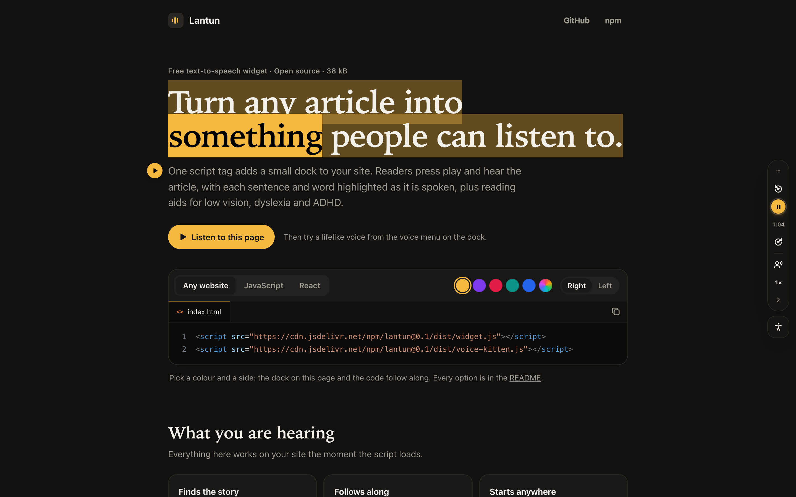
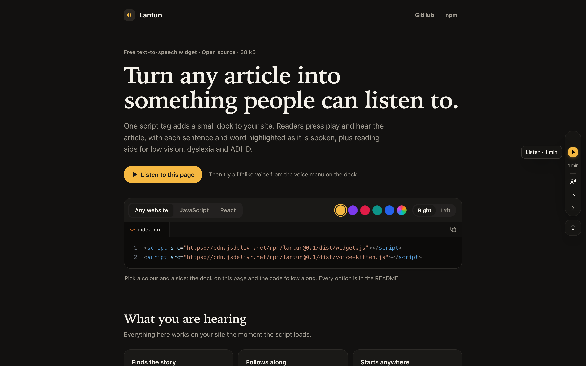
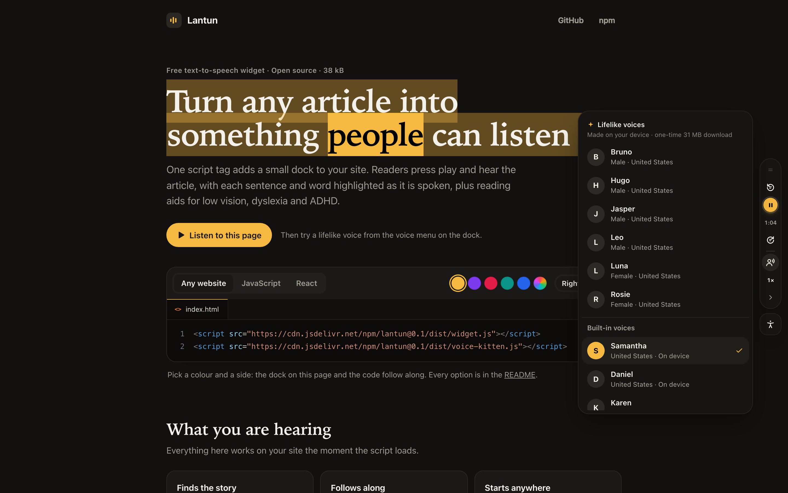
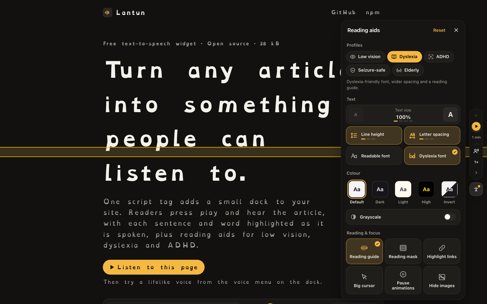
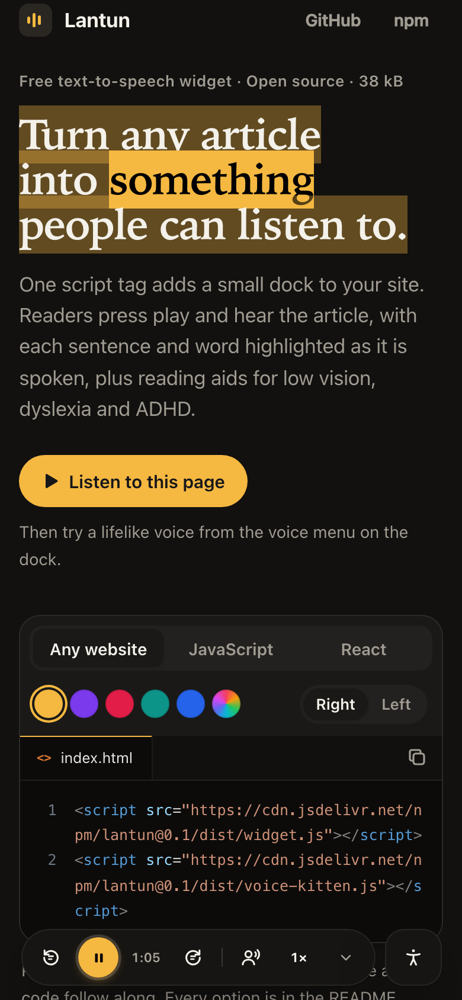

# lantun

**Add read-aloud to any website with one script tag: text-to-speech with sentence and word highlighting, plus reading aids for low vision, dyslexia and ADHD.**

Lantun adds a small dock to your page. Readers press play and hear the article while it highlights along. A second button opens reading aids: text size, spacing, dyslexia font, colour modes, reading guide and more. It works on plain HTML, WordPress, Ghost, Webflow or any CMS theme, with no build step, backend or account.

**[Try the live demo →](https://lantun.rzknkbr.xyz)** Open any sample article and press play.



## Usage

Paste these two lines before `</body>`:

```html
<script src="https://cdn.jsdelivr.net/npm/lantun@0.1/dist/widget.js"></script>
<script src="https://cdn.jsdelivr.net/npm/lantun@0.1/dist/voice-kitten.js"></script>
```

That's it. Lantun finds the article by itself, skipping menus, ads, captions and "Read also" links, and shows the dock when the page loads.

The second line adds lifelike English voices, generated on the reader's device. Keep it: browser voices often sound robotic. Nothing downloads until a reader picks one of these voices (about 31 MB, once).

## Options

Add attributes to the first tag. All are optional.

```html
<script
  src="https://cdn.jsdelivr.net/npm/lantun@0.1/dist/widget.js"
  data-content-selector="article .entry-content"
  data-color="#7c3aed"
></script>
```

| Attribute                | Default                  | What it does                                            |
| ------------------------ | ------------------------ | ------------------------------------------------------- |
| `data-content-selector`  | auto-detected            | Where the article body is.                              |
| `data-exclude-selectors` | none                     | Comma-separated selectors that are never read aloud.    |
| `data-position`          | `right`                  | Dock side: `right` or `left`.                           |
| `data-color`             | `#f5b841`                | Highlight and accent colour; any CSS colour.            |
| `data-lang`              | `<html lang>`, then `en` | Article language; picks the voices and the UI language. |
| `data-tts`               | `true`                   | `false` turns off listening.                            |
| `data-a11y`              | `true`                   | `false` turns off reading aids.                         |
| `data-z-index`           | `2147483000`             | Stacking order.                                         |
| `data-auto-init`         | `true`                   | `false` waits for you to call `LantunReader.init()`.    |

- **Skip part of the page:** add `data-reader-skip` to any element.
- **Strict Content-Security-Policy:** add your `nonce` to the script tag; Lantun reuses it for its styles.
- **Versions:** `lantun@0.1` gets bug fixes automatically, never breaking changes. Use `lantun@0.1.2` to pin an exact version.

## JavaScript API

The script exposes `window.LantunReader`:

| Function             | Description                                                                  |
| -------------------- | ---------------------------------------------------------------------------- |
| `init(options?)`     | Starts the widget (only needed with `data-auto-init="false"`).               |
| `destroy()`          | Removes everything Lantun added to the page.                                 |
| `play()` / `pause()` | Controls playback. Browsers allow `play()` only after a user interaction.    |
| `on(event, handler)` | Listens to `sentence`, `word`, `end` or `error`, and returns an unsubscribe. |

## Using a bundler?

Install [`@lantun/core`](https://www.npmjs.com/package/@lantun/core) for JavaScript apps, or [`@lantun/react`](https://www.npmjs.com/package/@lantun/react) for React and Next.js.

## A closer look

<table>
  <tr>
    <td width="50%"></td>
    <td width="50%"></td>
  </tr>
  <tr>
    <td><b>Quiet until needed.</b> A slim dock shows how long the article takes to hear. Drag it to any edge, or tuck it away.</td>
    <td><b>Lifelike voices.</b> Natural English voices made on the reader's device, downloaded once and only when chosen.</td>
  </tr>
  <tr>
    <td></td>
    <td align="center"></td>
  </tr>
  <tr>
    <td><b>Reading aids.</b> Text size, spacing, readable and dyslexia fonts, colour modes, reading guide and mask, and more.</td>
    <td><b>On phones.</b> The dock lies flat along the bottom, in thumb reach.</td>
  </tr>
</table>

## Links

- [Live demo](https://lantun.rzknkbr.xyz)
- [GitHub](https://github.com/rizkianakbar/lantun) (full docs and screenshots)
- [Issues](https://github.com/rizkianakbar/lantun/issues)

MIT licensed.
