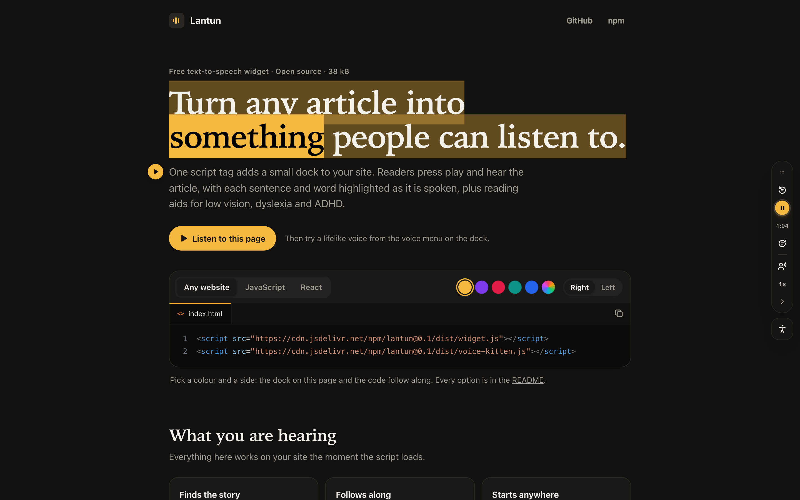
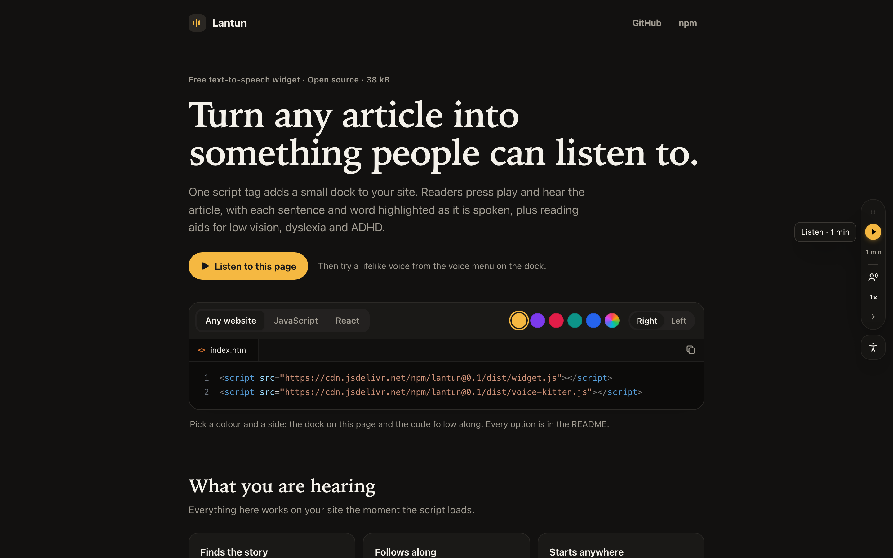
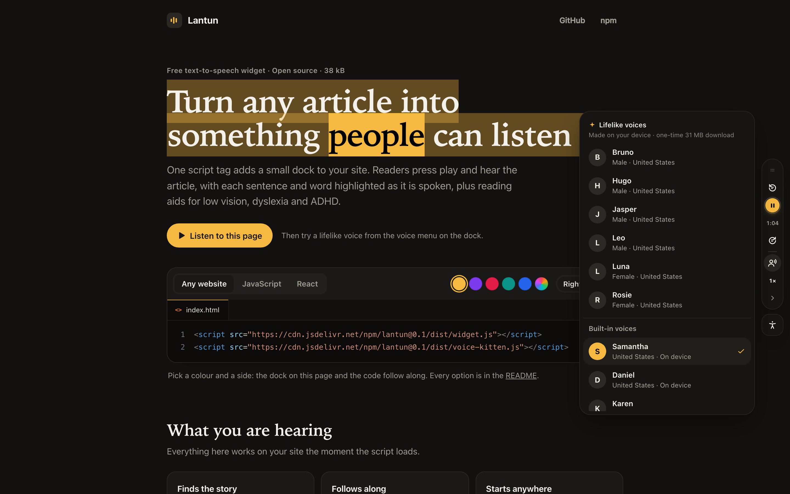
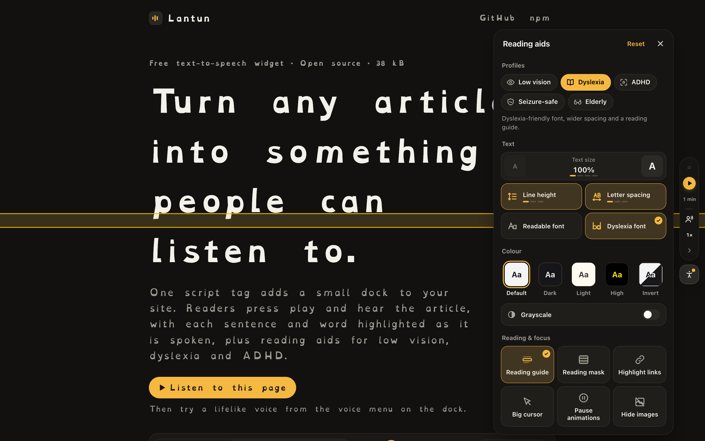
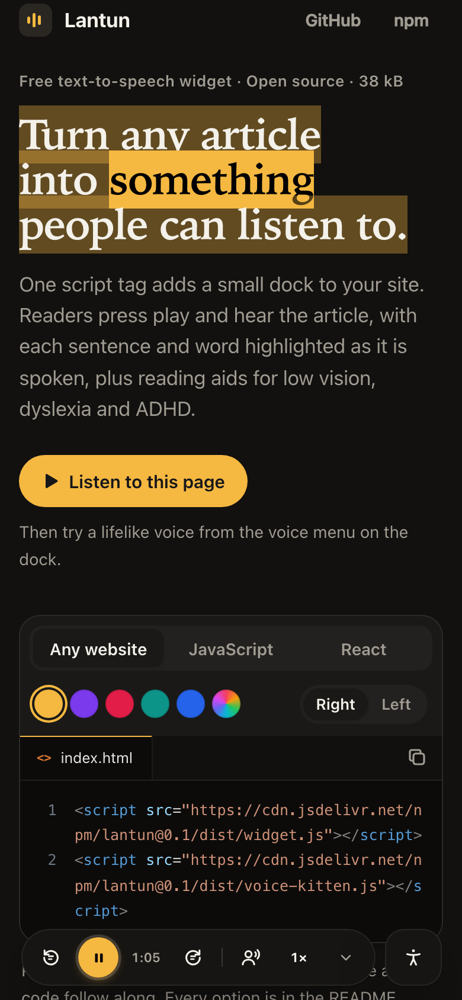

# @lantun/core

**Read any article aloud, with each sentence and word highlighted, plus reading aids for low vision, dyslexia and ADHD.**

Lantun adds a small dock to your page. Readers press play and hear the article while it highlights along. A second button opens reading aids: text size, spacing, dyslexia font, colour modes, reading guide and more. It finds the article by itself, runs entirely in the browser, and needs no backend or account.

**[Try the live demo →](https://lantun.rzknkbr.xyz)** Open any sample article and press play.



## Install

```sh
npm install @lantun/core @lantun/voice-kitten
```

`@lantun/voice-kitten` is optional but recommended. Browser voices differ by device and often sound robotic. The Kitten voices sound natural everywhere, run on the reader's device, and download nothing until a reader picks one.

## Usage

```ts
import { init, registerVoices } from "@lantun/core";
import { kittenVoices } from "@lantun/voice-kitten";

registerVoices(kittenVoices());
init({ contentSelector: "article", color: "#7c3aed" });
```

Call `init()` once the article is in the DOM. With no options, Lantun detects the article itself and skips menus, ads, captions, code blocks and "Read also" links. In a single-page app it notices when the article changes and reads the new one.

## Options

All options are optional.

| Option             | Default                     | What it does                                            |
| ------------------ | --------------------------- | ------------------------------------------------------- |
| `contentSelector`  | auto-detected               | Where the article body is.                              |
| `excludeSelectors` | `[]`                        | Selectors that are never read aloud.                    |
| `position`         | `"right"`                   | Dock side: `"right"` or `"left"`.                       |
| `color`            | `"#f5b841"`                 | Highlight and accent colour; any CSS colour.            |
| `lang`             | `<html lang>`, then `en`    | Article language; picks the voices and the UI language. |
| `features`         | `{ tts: true, a11y: true }` | Turn listening or reading aids off.                     |
| `zIndex`           | `2147483000`                | Stacking order of the dock.                             |
| `nonce`            | none                        | CSP nonce for Lantun's `<style>` elements.              |

To skip one element without a selector, add `data-reader-skip` to it.

## API

| Function                 | Description                                                                  |
| ------------------------ | ---------------------------------------------------------------------------- |
| `init(options?)`         | Starts the widget.                                                           |
| `destroy()`              | Removes everything Lantun added to the page.                                 |
| `play()` / `pause()`     | Controls playback. Browsers allow `play()` only after a user interaction.    |
| `on(event, handler)`     | Listens to `sentence`, `word`, `end` or `error`, and returns an unsubscribe. |
| `registerVoices(engine)` | Adds an add-on voice engine, such as `kittenVoices()`.                       |

```ts
import { on } from "@lantun/core";

const off = on("end", () => console.log("Finished the article"));
```

Turn on debug logs with `localStorage.setItem("lantun:debug", "1")`.

## Highlights

- **Follows along:** highlights the current sentence and word, and scrolls gently with them.
- **Starts anywhere:** hover a paragraph or select text, then press play.
- **Remembers:** returning readers continue from the same sentence.
- **Won't break your site:** the UI lives in a shadow root, survives hostile CSS and strict CSPs, and never throws into your page.
- **Light:** about 38 kB gzipped.
- **Accessible:** keyboard-operable, screen-reader friendly, checked with axe.
- **Bilingual UI:** English and Indonesian, from the page language.

## Other setups

- **No build step?** Use the [`lantun`](https://www.npmjs.com/package/lantun) script tag.
- **React or Next.js?** Use [`@lantun/react`](https://www.npmjs.com/package/@lantun/react).

## A closer look

<table>
  <tr>
    <td width="50%"></td>
    <td width="50%"></td>
  </tr>
  <tr>
    <td><b>Quiet until needed.</b> A slim dock shows how long the article takes to hear. Drag it to any edge, or tuck it away.</td>
    <td><b>Lifelike voices.</b> Natural English voices made on the reader's device, downloaded once and only when chosen.</td>
  </tr>
  <tr>
    <td></td>
    <td align="center"></td>
  </tr>
  <tr>
    <td><b>Reading aids.</b> Text size, spacing, readable and dyslexia fonts, colour modes, reading guide and mask, and more.</td>
    <td><b>On phones.</b> The dock lies flat along the bottom, in thumb reach.</td>
  </tr>
</table>

## Links

- [Live demo](https://lantun.rzknkbr.xyz)
- [GitHub](https://github.com/rizkianakbar/lantun) (full docs and screenshots)
- [Issues](https://github.com/rizkianakbar/lantun/issues)

MIT licensed.
