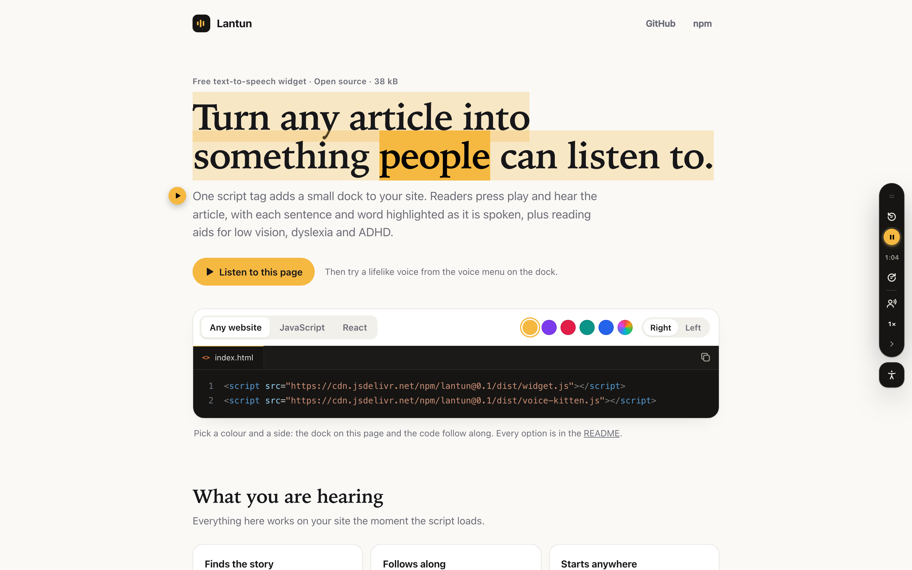

# @lantun/react

**A read-aloud widget for React: text-to-speech with sentence and word highlighting, plus reading aids for low vision, dyslexia and ADHD.**

Drop `<LantunWidget />` on an article page. Readers get a small dock: press play to hear the article as it highlights along, or open the reading aids for text size, spacing, a dyslexia font, colour modes and more. It runs entirely in the browser, with no backend or account.

**[Try the live demo →](https://lantun.rzknkbr.xyz)** Open any sample article and press play.



## Install

```sh
npm install @lantun/react @lantun/voice-kitten
```

Requires React 17 or later. `@lantun/voice-kitten` is optional but recommended. Browser voices often sound robotic, while these natural voices run on the reader's device and download nothing until a reader picks one.

## Usage

```tsx
import { LantunWidget, registerVoices } from "@lantun/react";
import { kittenVoices } from "@lantun/voice-kitten";

registerVoices(kittenVoices());

export function ArticlePage() {
  return (
    <>
      <article>…</article>
      <LantunWidget contentSelector="article" color="#7c3aed" />
    </>
  );
}
```

`<LantunWidget />` renders nothing in your tree. It starts the widget on mount, restarts it only when its props change, and removes it on unmount. It is safe under `StrictMode`. Render one per page.

## Props

All props are optional.

| Prop               | Default                     | What it does                                            |
| ------------------ | --------------------------- | ------------------------------------------------------- |
| `contentSelector`  | auto-detected               | Where the article body is.                              |
| `excludeSelectors` | `[]`                        | Selectors that are never read aloud.                    |
| `position`         | `"right"`                   | Dock side: `"right"` or `"left"`.                       |
| `color`            | `"#f5b841"`                 | Highlight and accent colour; any CSS colour.            |
| `lang`             | `<html lang>`, then `en`    | Article language; picks the voices and the UI language. |
| `features`         | `{ tts: true, a11y: true }` | Turn listening or reading aids off.                     |
| `zIndex`           | `2147483000`                | Stacking order of the dock.                             |
| `nonce`            | none                        | CSP nonce for Lantun's `<style>` elements.              |

To skip one element without a selector, add `data-reader-skip` to it.

Need `play()`, `pause()` or events such as `on("end", …)`? Import them from [`@lantun/core`](https://www.npmjs.com/package/@lantun/core), which this package installs for you.

## Links

- [Live demo](https://lantun.rzknkbr.xyz)
- [GitHub](https://github.com/rizkianakbar/lantun) (full docs and screenshots)
- [Issues](https://github.com/rizkianakbar/lantun/issues)

MIT licensed.
