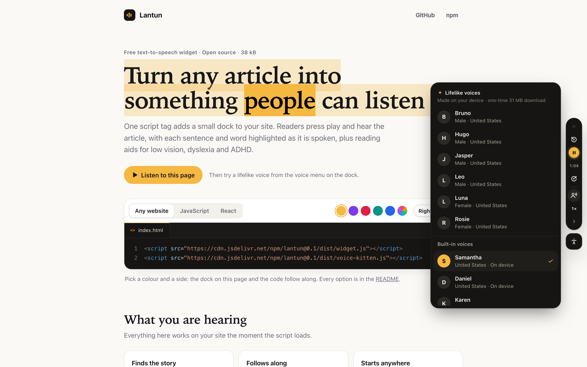

# @lantun/voice-kitten

**Lifelike English voices for [Lantun](https://www.npmjs.com/package/@lantun/core), generated on the reader's device with [Kitten TTS](https://github.com/KittenML/KittenTTS).**

Browser voices differ by device, and many sound robotic. This add-on gives every reader the same natural voices. They run in a web worker in the browser, so you don't need a server or an API key, and you pay nothing per use.

**[Hear them in the live demo →](https://lantun.rzknkbr.xyz)** Open an English article, press play, and pick a voice from the voice menu.



## Install

```sh
npm install @lantun/core @lantun/voice-kitten
```

## Usage

```ts
import { init, registerVoices } from "@lantun/core";
import { kittenVoices } from "@lantun/voice-kitten";

registerVoices(kittenVoices());
init();
```

The voices appear in Lantun's voice menu next to the browser's own voices. With React, import `registerVoices` from `@lantun/react` instead; it's the same function.

## What readers download

**Nothing, until they pick one of these voices.** Then the model and runtime download once (about 31 MB) and are cached by the browser. A few sentences into a first listen, Lantun suggests these voices to the reader. They're not offered when Data Saver is on or on devices with little memory, and if a device can't generate speech fast enough, Lantun goes back to the browser's voices.

The voices speak English. Articles in other languages use the browser's voices.

## Options

```ts
kittenVoices({
  voices: ["Luna", "Jasper"], // offer only some voices
  sources: { model: "https://your-cdn.example/kitten.onnx" }, // self-host any file
});
```

| Option    | Default     | What it does                                                                                           |
| --------- | ----------- | ------------------------------------------------------------------------------------------------------ |
| `voices`  | all         | Voices to offer: `Jasper`, `Luna`, `Bruno`, `Rosie`, `Hugo`, `Leo`.                                    |
| `sources` | public CDNs | Override any of `model`, `voices`, `config` (Hugging Face), `ort`, `ortWasm`, `phonemizer` (jsDelivr). |

## Script tag

With the [`lantun`](https://www.npmjs.com/package/lantun) script tag, add the voices as a second tag:

```html
<script src="https://cdn.jsdelivr.net/npm/lantun@0.1/dist/widget.js"></script>
<script src="https://cdn.jsdelivr.net/npm/lantun@0.1/dist/voice-kitten.js"></script>
```

## Links

- [Live demo](https://lantun.rzknkbr.xyz)
- [GitHub](https://github.com/rizkianakbar/lantun)
- [Issues](https://github.com/rizkianakbar/lantun/issues)

MIT licensed. The Kitten TTS model is Apache-2.0.
